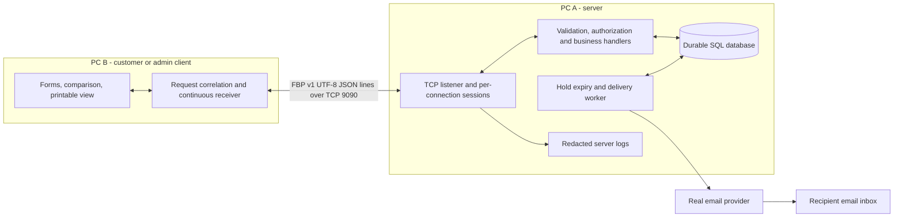

# Flight Search and Booking — application design

Design-review deliverable, revised 2026-11-05. Read [README](README.md) for source precedence, proposed decisions and validation limits. The protocol and examples are specifications; no application has been implemented.

## Problem, users and scope

Customers need one place to find flights from several airlines, compare price and travel time, reserve seats, pay, retrieve tickets and manage changes. Airline staff need to inform affected customers when flights change, are delayed or are cancelled. A successful purchase must connect the same booking, inventory, balance movement and ticket records even when a connection is lost.

The topic in [Docs/topic.md](../Docs/topic.md) defines nine graded requirements (20 points total). Lecturer notes permit account-balance payment and mocked flights, and require an admin to trigger notifications. The user has confirmed **R7: real email sending only, with SMS excluded**. The server must send e-ticket codes to a real recipient mailbox through an email provider; successful local queue creation alone does not complete R7.

This milestone is the design presentation described by [Requirement.png](../Docs/Requirement.png) and the lecture PDF, pages 22 and 24. The later implementation, two-PC demo and hard-copy evaluation report on pages 21 and 23 remain future work.

## Architecture and responsibilities

Multiple customer/admin client processes may connect concurrently. Each socket has its own login state; multiple sockets may belong to one user. The server routes each persisted notification to that user's authenticated customer connections. Admin requests use the same listener and protocol. There is no client-to-client link.

| Component | Owns |
|---|---|
| Client | Forms, local validation, pending request ID/key, displaying responses and notifications, local print/save |
| Server transport/session | Direct socket accept/read/write, bounded framing buffer, login identity, ordered outgoing frames |
| Business handlers | Authoritative validation, roles/ownership, prices, seat eligibility, quotes, atomic transactions |
| SQL store | Users, flights/fares, bookings/legs/passengers/tickets, balance ledger, quotes, notification inbox, delivery jobs and idempotency results |
| Background worker | Expire holds, send queued real emails through the provider, resume retryable jobs after restart; never charge again to retry email |
| Logging | Receipt/rejection, send attempt/completion/failure and connection lifecycle, with sensitive data removed |

Choose a single server process and durable SQL storage; SQLite is a proposed engine, not a lecture requirement. In-memory data alone cannot support the specified restart recovery. A single `domainLock` and SQL transaction serialize domain mutations for this small mocked dataset; network and file I/O happen after commit. Details: [processing tables](processing-tables.md).

## Connection and technology choices

Use persistent TCP with one UTF-8 JSON object followed by LF per message, at most 65,536 payload bytes. TCP supplies reliable ordered bytes; FBP adds boundaries, request IDs, authorization, durable mutation keys and stored notifications. Read buffers handle split/coalesced frames, and send loops handle short writes. Details: [message specification](message-spec.md).

The PDF page 21 explicitly requires a server in **C, C++ or Java**, direct socket handling, a custom protocol and client/server execution on **two separate PCs**. The client language is not specified by that sentence; using the same language is a proposal. Choose the language before implementation. No HTTP framework substitutes for this interface.

The sample data is synthetic. Airport dates use Asia/Ho_Chi_Minh (`+07:00`); timestamps include the offset. Fares and balances are integer VND. Direct domestic flights, one outbound and optional return leg, 1–9 adults, ten-minute holds and the change-fee policy remain proposed scope choices. Cancellation refunds are confirmed by the user: full fare when at least two hours away or disrupted before departure; live unpaid bookings only release holds.

## Functionality and use cases

| ID | Actor / goal | Boundary messages | Source |
|---|---|---|---|
| UC01 | Guest registers | `REGISTER` | R3 |
| UC02 | Customer/admin logs in or out | `LOGIN`, `LOGOUT` | R3 |
| UC03 | Customer searches one-way or return flights | `SEARCH_FLIGHTS` | R4 |
| UC04 | Customer compares airlines, prices and duration | `COMPARE_FLIGHTS` | R5 |
| UC05 | Customer reserves selected legs | `BOOK_FLIGHT` | R6 |
| UC06 | Customer pays from balance | `PAY_BOOKING`, `GET_BALANCE` | R6 |
| UC07 | Customer receives/retrieves/resends e-ticket code | payment result, `GET_BOOKING`, `RESEND_TICKET` | R7 |
| UC08 | Customer views own bookings | `LIST_BOOKINGS`, `GET_BOOKING` | R8 |
| UC09 | Customer cancels booking | `CANCEL_BOOKING` direct apply; optional preview | R8 |
| UC10 | Customer changes one leg | `CHANGE_BOOKING` quote then apply | R8 |
| UC11 | Customer prints or saves ticket | `PRINT_TICKET`, then local print/save | R8 |
| UC12 | Customer receives/reviews notifications | `NOTIFY`, `GET_NOTIFICATIONS`, `ACK_NOTIFICATION` | R9 |
| UC13 | Admin delays/reschedules flight | `ADMIN_LIST_FLIGHTS`, `ADMIN_UPDATE_FLIGHT` | R9; admin note |
| UC14 | Admin cancels flight | `ADMIN_UPDATE_FLIGHT` action CANCEL | R9; admin note |

Socket management (R1), redacted receipt/send logs (R2), expiry and delivery retry support these goals. Exact client/server steps and failure branches for all 14 cases are in [use-case-flows.md](use-case-flows.md). Business policies and permissions remain in [business-flow.md](business-flow.md).

## Two-PC validation plan — not yet executed

1. Build the server in an allowed language using sockets directly, and build the client against the FBP contract. Seed the same synthetic data and test clock used by the transcript.
2. On PC A, configure bind address `0.0.0.0` (or its LAN interface) and port `9090`. On PC B, configure the actual reachable LAN address of PC A, for example `192.168.1.10:9090`; clients never connect to `0.0.0.0`. A localhost run alone cannot satisfy this check.
3. Arrange LAN connectivity and an inbound firewall rule for the chosen server executable/port. Record OS, build/version, actual addresses and firewall setup in demo evidence; do not alter firewall settings as part of this document review.
4. Connect a customer on PC B and an admin in a second client. Show `PING`, registration/login, search/compare, reserve/pay, print and notification retrieval. Trigger DELAY, RESCHEDULE and CANCEL from admin with fresh/versioned fixtures for each scenario.
5. Disconnect a customer during payment and during an admin update. Reconnect/login; recover the same payment result and retrieve missed notifications. Run a second customer against a last-seat fixture. Exercise fragmentation, coalescing, invalid input and short writes with an instrumented socket harness.
6. Record request IDs, redacted server logs and both screens. Pass only when balances/ledger, seats, booking status and notification IDs reconcile. For R7, show a real e-ticket email arriving in a team-controlled mailbox and match its booking/ticket codes to the app. Replace synthetic example addresses with controlled test recipients during implementation/demo; no real email sending has been executed by this document review.

Runtime evidence must name which acceptance scenarios passed and which were not run. No such evidence is claimed by the design-package validator.
