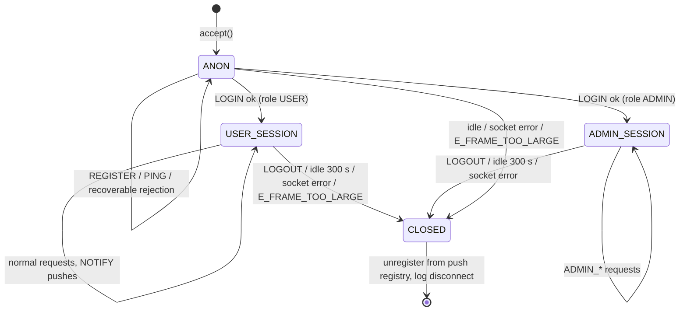
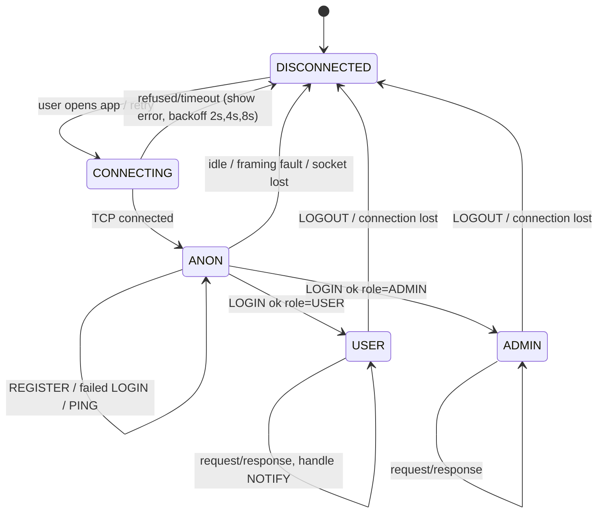
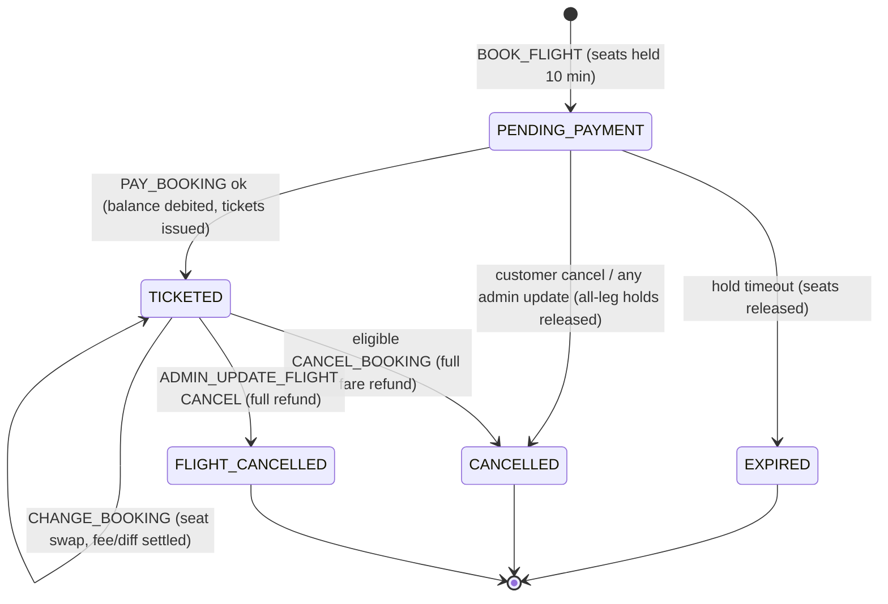
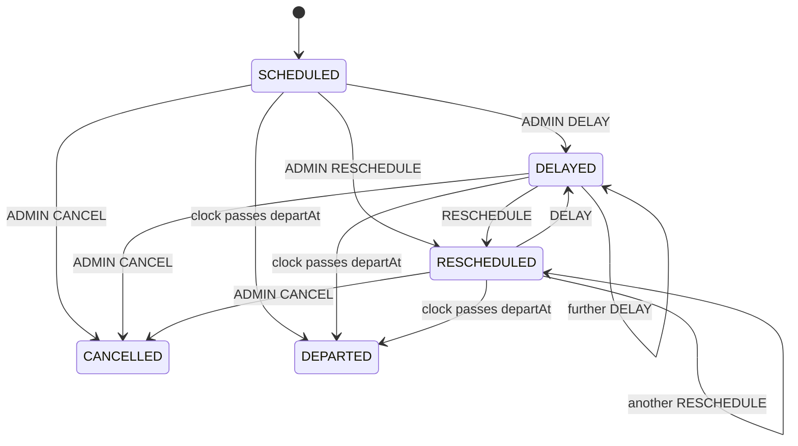
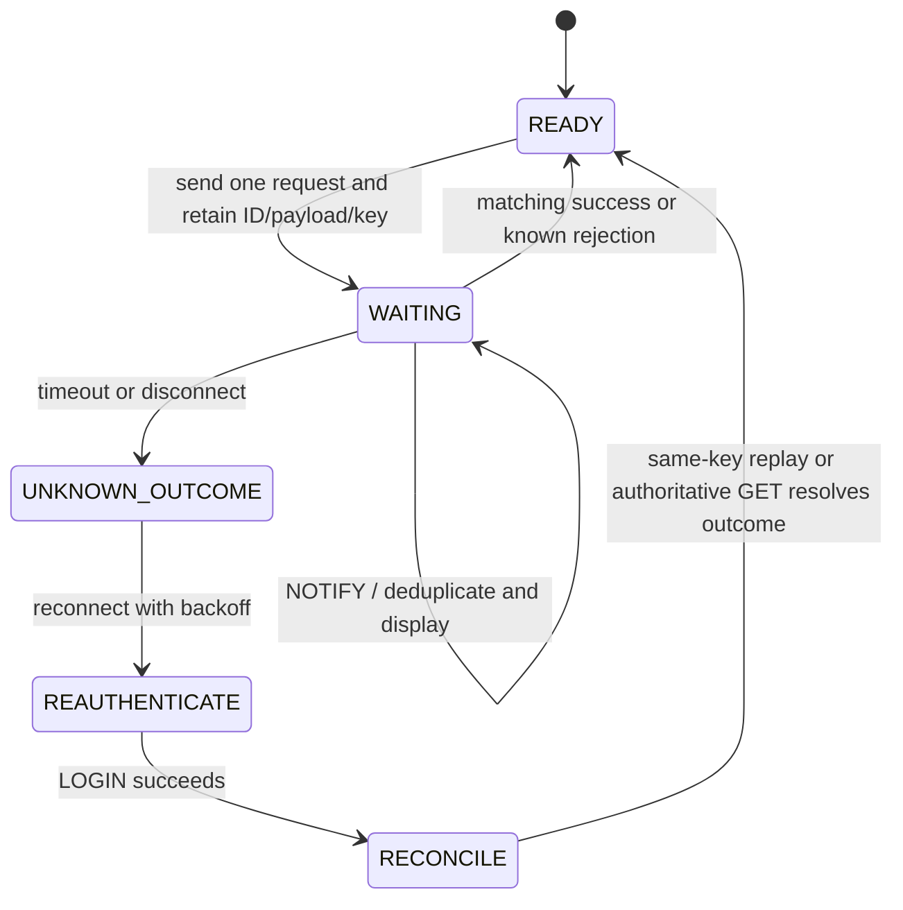

# State machines

## 1. Server — per-connection session

Server loop: assemble bounded byte line → strict parse → log redacted receipt/rejection → validate/authenticate → process using domainLock and SQL transaction → enqueue reply → write all bytes → log send completion/failure. Queue LOGIN success before enabling that connection for pushes. Remove it from the registry on close. A malformed complete line does not terminate the server; framing faults close only that connection.

## 2. Client — connection and UI state

Client rules:
- One outstanding request; timeout 10 s → treat connection as lost, reconnect, `LOGIN`, then resolve the uncertain request (see §5).
- Reader thread dispatches `NOTIFY` to the UI immediately, and responses to the waiting caller by `id`.
- After customer (re)login: retrieve unread notification pages; refresh bookings and balance after uncertain operations. Admin login does not return unreadNotifications.
- `PING` every 60 s while idle.

## 3. Booking lifecycle

Terminal bookings accept read operations. A successful durable-key replay returns its saved result even if the current booking is terminal. Otherwise PAY on EXPIRED → `E_HOLD_EXPIRED`; PAY on an admin-invalidated hold → `E_FLIGHT_UNAVAILABLE`; PRINT/RESEND and other ineligible state operations → `E_STATE_CONFLICT`. CHANGE_BOOKING applies first check quote expiry/consumption/snapshots, which can instead yield `E_QUOTE_EXPIRED`/`E_VERSION_CONFLICT`. PRINT/RESEND require TICKETED. Paid bookings cannot cancel/change after their earliest current departure; disruption does not bypass this guard.

## 4. Flight lifecycle

`DEPARTED` is derived when departAt ≤ now for an active flight; CANCELLED never becomes DEPARTED. Every admin update increments version. Disruption uses absolute **net** difference from each booking leg's accepted departure, including earlier reschedules; it is not a sum of absolute edits. A successful customer replacement accepts a new baseline for that leg.

## 5. Resolving an uncertain request after connection loss

| Request in flight | After reconnect + login | Why safe |
|---|---|---|
| read-only (`SEARCH`, `LIST`, `GET`, `PRINT`…) | resend | no effect |
| applied `BOOK_FLIGHT`, `PAY_BOOKING`, `CHANGE_BOOKING`, `CANCEL_BOOKING`, `ADMIN_UPDATE_FLIGHT` | resend same payload and **same** durable key with a new connection request ID | replay is checked before stale booking/version/quote checks; no repeated charge/refund/delay |
| dry-run cancellation | optionally repeat preview, or cancel directly with a stable key | no quote is stored; apply checks current eligibility |
| dry-run change | request a new quote and review it | no seats/money were changed; old change quote may have expired |
| `REGISTER` | `LOGIN`; if it works the registration succeeded | — |

## 6. Guarded server transition table

| Current | Receive / trigger | Guard and processing | Send | Next |
|---|---|---|---|---|
| ANON | REGISTER | Validate and create USER, no login | REGISTER_RESP success/error | ANON |
| ANON | LOGIN | Credentials valid; read server role; queue reply before push registration | LOGIN_RESP profile | USER_SESSION or ADMIN_SESSION |
| ANON | Failed LOGIN | Unknown user/wrong password identical | E_BAD_CREDENTIALS | ANON |
| ANON | Authenticated-only request | No bound identity | E_NOT_AUTHENTICATED | ANON |
| USER/ADMIN | REGISTER or LOGIN | Already bound | E_ALREADY_LOGGED_IN | unchanged |
| Any connected | PING | Valid envelope | PING_RESP | unchanged |
| USER/ADMIN | Role-ineligible request | Authoritative stored role | E_FORBIDDEN | unchanged |
| USER/ADMIN | Permitted request | Payload, ownership, transaction guards; no cross-account access | Typed success or catalog error | unchanged |
| USER/ADMIN | LOGOUT | Queue/flush response, unregister | LOGOUT_RESP then EOF | CLOSED |
| Any connected | Complete invalid line/envelope | No business dispatch | ERROR_RESP | unchanged |
| Any connected | Oversize | Bound exceeded | ERROR_RESP if possible, close | CLOSED |
| Any connected | Frame deadline, idle, EOF, socket fault | Discard incomplete suffix; committed mutations persist | no guaranteed reply | CLOSED |

## 7. Client request submachine

READY/WAITING are request states within a connected session, not proof of authentication. LOGIN success selects USER/ADMIN; logout success leaves DISCONNECTED. Wrong response ID/type or invalid server data closes the connection and uses the same reconciliation path. An error response completes the pending call, while a push never does.

## 8. Quotes, delivery and ticket validity

Change quotes only: VALID → CONSUMED by successful apply; VALID → EXPIRED when now ≥ expiry; VALID → STALE when bound booking/flight/amount/policy changes. Stale/consumed different-key apply returns E_VERSION_CONFLICT; expired returns E_QUOTE_EXPIRED. Quote creation holds no seats. These states are derived/stored server-side and are not BookingStatus values.

Email delivery: QUEUED → SENT (real provider accepts the email) or FAILED; retryable FAILED → QUEUED on retry. Restart resumes durable jobs; delivery never changes TICKETED to an unpaid state. Payment's persisted reply snapshot is QUEUED; inspect GET_BOOKING for the latest email job status. Provider acceptance does not prove mailbox receipt/read; a timeout or crash after acceptance may cause duplicate email on retry. Obsolete jobs remain nonretryable FAILED (SUPERSEDED).

Ticket validity: unissued while pending; valid only on the TICKETED booking's current revision/legs; cancellation makes the historical ticket invalid. Change retains the simplified ticket number but invalidates cached itinerary/print data. Printing does not change validity.
