# Use-case procedures and communication diagrams

These procedures implement UC01–UC14 from [application-design.md](application-design.md) using the current FBP names. [message-spec.md](message-spec.md) gives exact envelopes, fields and bounds; [wire-examples.md](wire-examples.md) supplies complete serialized messages. Diagram parameters abbreviate those payloads and do not add wire fields. C is the client and S the server; DB denotes the server-owned SQL store.

## Shared behavior for every use case

Client validates for usability; server repeats authoritative validation. Each request carries v=1, type, a fresh connection-local id and object data. Each expected reply is the request type plus _RESP, echoes id and contains ok/code/data (message on failure). The reader continuously dispatches NOTIFY by type while waiting for a correlated reply. One request is outstanding per connection.

All common errors in [error-catalog.md](error-catalog.md) apply: framing/envelope errors never invoke business handlers; auth/role failures preserve the session; field errors highlight input; E_INTERNAL before commit rolls back. Known failure completes the pending call. A timeout/disconnect is an **unknown outcome**: reconnect/login, then replay applied mutations with original payload/key and a fresh request ID; never infer failure from missing response. Successful replay precedes current state/version/quote checks. Afterwards retrieve current state. Reads may be repeated. These shared rules are part of every procedure below.

The server uses domainLock and SQL transaction as specified in [processing-tables.md](processing-tables.md). Network/file writes are outside the transaction. All received/sent/rejected frames are logged with redaction and send attempt/completion distinction. Use the catalog's per-message errors together with the specific branches below.

## UC01 — Register (R3)

Actor / preconditions: Guest on an ANON connection submits username/password/name/email.

1. Client checks required fields and sends REGISTER. Server normalizes username, validates policy, hashes password, and inserts exactly one USER with seeded balance.
2. REGISTER_RESP OK displays account creation and offers login; the connection remains ANON.
3. E_USERNAME_TAKEN offers another username; E_VALIDATION identifies a field. No partial account on storage failure. A lost response is reconciled with LOGIN; repeating registration can legitimately return username taken.

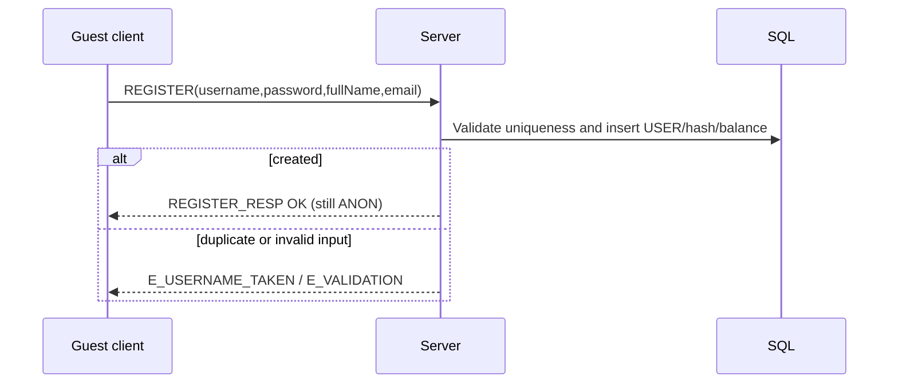

Coverage: AS-05; examples #5–8.

## UC02 — Log in / out (R3)

Actor / preconditions: Customer/admin has an account; login starts ANON. Logout starts authenticated.

1. Client sends LOGIN credentials. Server checks stored hash and derives role from SQL, queues LOGIN_RESP before enabling pushes.
2. Client selects USER/ADMIN menus from the reply. Customer retrieves unread pages after login; admin does not receive balance/unread fields.
3. E_BAD_CREDENTIALS keeps ANON and does not reveal which credential failed. A second login/registration on the same authenticated connection yields E_ALREADY_LOGGED_IN.
4. LOGOUT returns success, then server unregisters/closes. A socket disconnect ends only that connection's session; committed bookings survive.

```mermaid
sequenceDiagram
    participant C as Customer or admin client
    participant S as Server
    C->>S: LOGIN(username,password)
    alt credentials valid
        S-->>C: LOGIN_RESP OK(role and permitted profile)
        Note over C,S: Session authenticated; customer catches up notifications
        C->>S: LOGOUT({})
        S-->>C: LOGOUT_RESP OK
        S-->>C: Close TCP connection
    else invalid credentials
        S-->>C: E_BAD_CREDENTIALS (remain ANON)
    end
```

Coverage: AS-06/07/26; login examples #9–12 and #41–42; logout in supporting transcript.

## UC03 — Search flights (R4)

Actor / preconditions: Authenticated USER supplies route, outbound date, optional return date, class and 1–9 passengers.

1. Client validates criteria and sends SEARCH_FLIGHTS; server validates dates/route, expires stale holds and filters eligible flights/fares.
2. Server prices all passengers and returns sorted outbound/inbound arrays. Return direction reverses airports; no returnDate means inbound=[].
3. Client displays airline, local times, elapsed duration, price and free seats. Empty arrays are success, not an error; E_VALIDATION preserves entered criteria. No seats are held.

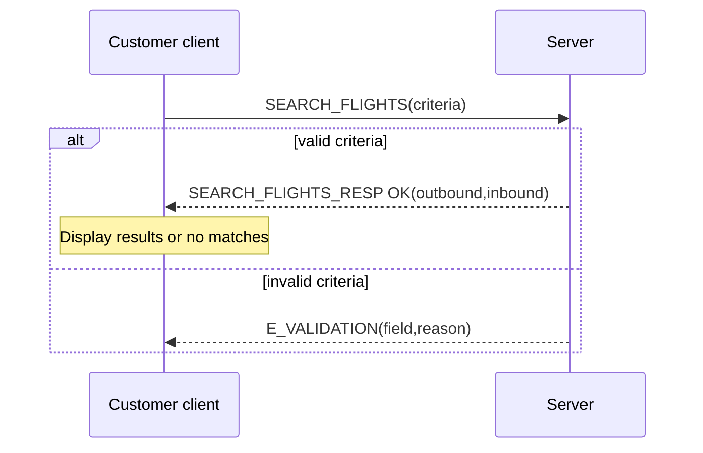

Coverage: AS-08/09; examples #13–16.

## UC04 — Compare flights (R5)

Actor / preconditions: USER selects 2–5 distinct options on the same route/date, class and passenger basis.

1. Client sends COMPARE_FLIGHTS. Server resolves IDs and checks route/date/class and current availability.
2. Compute pricePerPax×passengers, elapsed duration, cheapest/fastest and deltas; ties use flightId. Return rows in request order.
3. Client renders comparison and allows selection. E_NOT_FOUND refreshes search; E_VALIDATION fixes selection; E_FLIGHT_UNAVAILABLE/E_SEATS_UNAVAILABLE refresh current options. Comparison never reserves inventory.

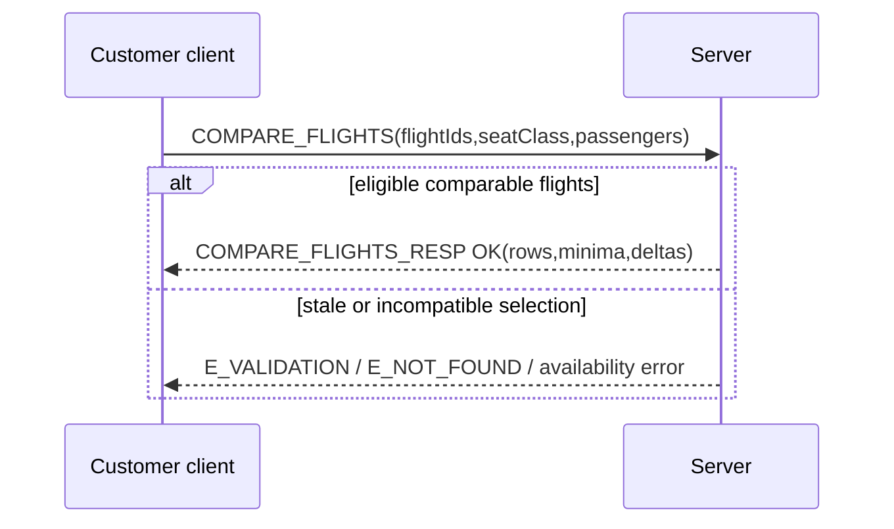

Coverage: AS-10; examples #17–18.

## UC05 — Reserve selected flights (R6)

Actor / preconditions: Authenticated USER supplies 1–9 adult passengers, contactEmail, class and one/optional return flight.

1. Client retains a stable BOOK key and sends BOOK_FLIGHT. Server checks replay, both legs' route/time order, passenger/contact data and current flight/inventory.
2. In one transaction reserve all legs or none, create PENDING_PAYMENT revision 1 with stored fare and ten-minute expiry, and save the replay result.
3. Client displays the authoritative total/itinerary for explicit payment confirmation. E_SEATS_UNAVAILABLE/E_FLIGHT_UNAVAILABLE trigger reselection; E_NOT_FOUND refreshes IDs. Failure creates no partial hold. An abandoned booking expires without a debit.

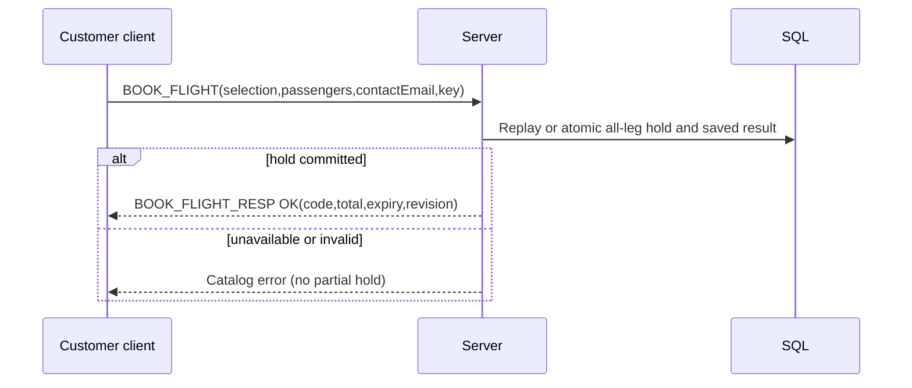

Coverage: AS-11/14/26; examples #19–24.

## UC06 — Pay booking (R6)

Actor / preconditions: USER owns an unexpired PENDING_PAYMENT booking and accepts its stored total.

1. Client sends PAY_BOOKING with bookingCode, method label and stable key. No real card/wallet credentials are collected.
2. Server checks replay/ownership, expiry/invalidation, flight eligibility and balance in the serialized transaction.
3. Atomically debit, write ledger, convert held seats to sold, set TICKETED/revision+1, issue tickets, persist delivery jobs and the QUEUED success snapshot.
4. Client displays tickets and balance. E_INSUFFICIENT_BALANCE keeps the live hold; E_HOLD_EXPIRED releases it once; an admin-invalidated hold yields E_FLIGHT_UNAVAILABLE. Different-key payment of a ticketed booking yields E_STATE_CONFLICT. Delivery failure does not fail payment.

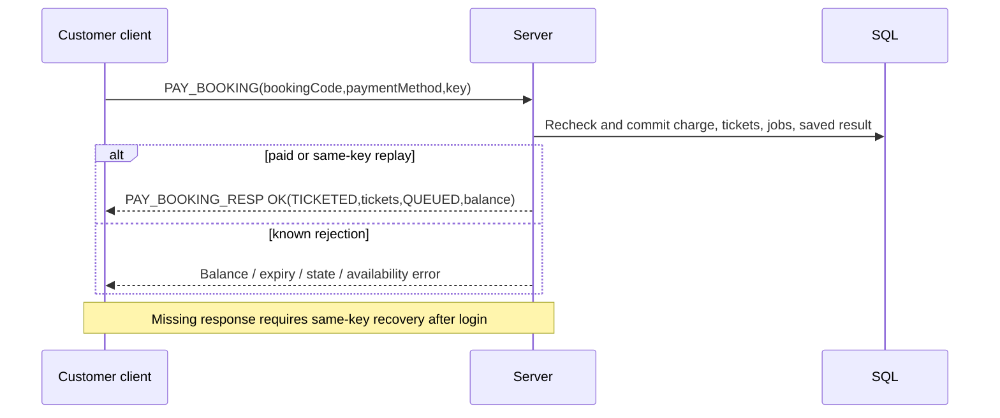

Coverage: AS-12–15/26; examples #21–26.

## UC07 — Obtain / resend e-ticket (R7)

Actor / preconditions: USER owns a TICKETED booking; payment has already made ticket data and durable delivery jobs available.

1. Client can show payment tickets immediately, or GET_BOOKING for current tickets and delivery.
2. Worker sends a real e-ticket email to saved contactEmail after commit. Job starts QUEUED; provider acceptance records SENT; error/timeout records FAILED with bounded retry/restart recovery. SENT alone does not prove mailbox receipt or reading.
3. Client sends RESEND_TICKET with bookingCode only. Server creates an email job using existing codes and saved recipient, then replies with channel EMAIL, masked email and job status. No phone/channel selector or destination override is accepted.
4. E_NOT_FOUND hides unowned records; E_STATE_CONFLICT rejects unpaid/cancelled bookings. A lost resend reply or uncertain provider acceptance may cause duplicate emails on retry, never another charge/code. R7 acceptance requires a real inbox receipt containing the matching booking and ticket codes.

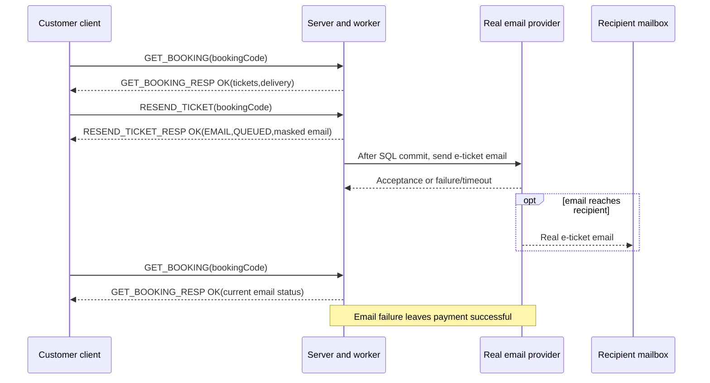

Coverage: AS-15/16/35; examples #26–28.

## UC08 — View bookings (R8)

Actor / preconditions: Authenticated USER opens own booking list or details.

1. Client sends LIST_BOOKINGS with optional filter/limit/offset and follows nextOffset.
2. Selecting an entry sends GET_BOOKING. Server filters by owner and returns current status, revision, passengers, itinerary, totalPaid, ticket history and delivery.
3. Client deduplicates pagination IDs and clearly labels expired/cancelled tickets invalid. Empty list is success. Missing/unowned codes both yield E_NOT_FOUND; no other customer's data is returned.

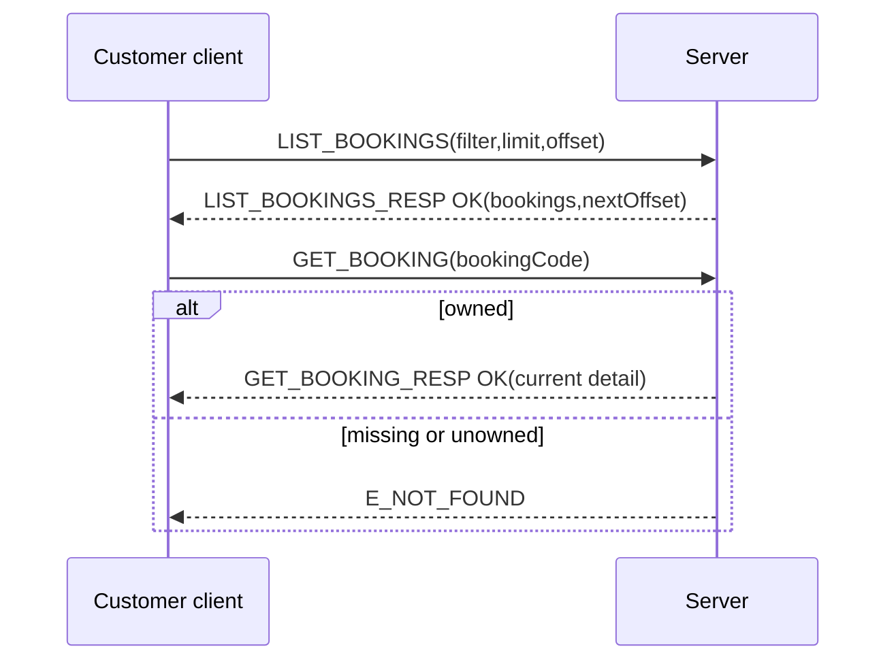

Coverage: AS-17; examples #29–32.

## UC09 — Cancel booking (R8)

Actor / preconditions: USER owns a live PENDING_PAYMENT or eligible TICKETED booking; paid booking has not departed.

1. Optionally send CANCEL_BOOKING dryRun=true to display the current refund; no quote is created and no seats/money move.
2. Customer confirms cancellation. Send bookingCode and a stable idempotencyKey, with dryRun=false or omitted; no quoteId is required.
3. Server replays or checks current state and eligibility: live pending → release holds/refund zero; paid ≥2 h → full fare refund; disrupted before departure → full fare refund; other paid <2 h → E_CANCEL_NOT_ALLOWED. Atomically release all legs, credit the refund when nonzero, set CANCELLED/revision+1 and save the result.
4. E_CANCEL_NOT_ALLOWED explains the cutoff; E_STATE_CONFLICT requires refresh. Preview is advisory, so apply uses the current booking. Same-key replay never refunds twice.

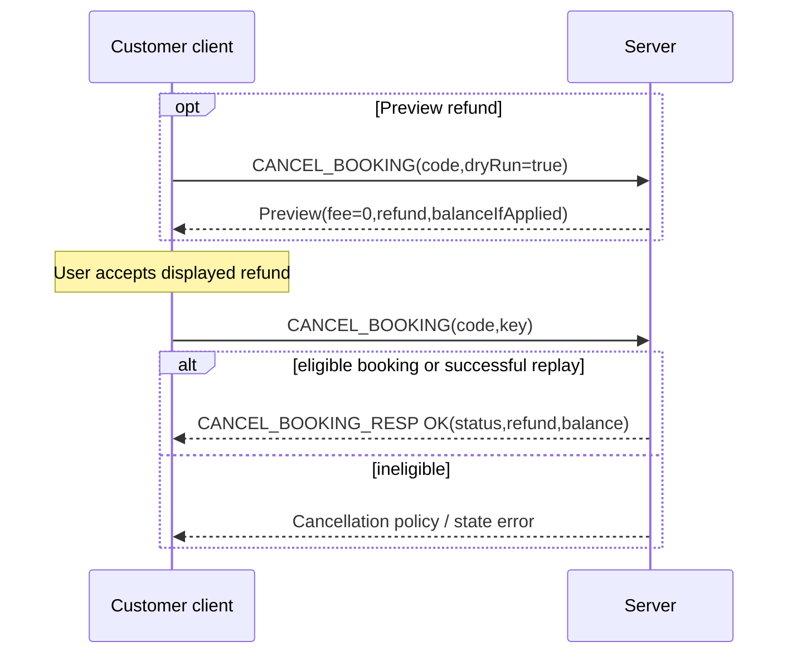

Coverage: AS-20/23/31; examples #50–53 and #74–77.

## UC10 — Change one booking leg (R8)

Actor / preconditions: USER owns TICKETED booking; every current leg and the replacement depart at least two hours later.

1. Customer searches replacement, then sends CHANGE_BOOKING dryRun=true with bookingCode, legType and newFlightId.
2. Server checks route/class/round-trip order/inventory and returns owned quote, fee, difference, net and expiry. No replacement seats are held.
3. Client obtains acceptance and applies with quoteId and stable key. Server replays or atomically rechecks quote/inventory/balance and swaps seats, settles signed net, updates fare/net paid/revision/baseline, keeps ticket identifiers and queues revised delivery.
4. E_QUOTE_EXPIRED/E_VERSION_CONFLICT require a fresh quote; E_SEATS_UNAVAILABLE/E_FLIGHT_UNAVAILABLE require reselection; E_INSUFFICIENT_BALANCE or E_CHANGE_NOT_ALLOWED preserves original itinerary/tickets. Equal/negative net does not require a debit.

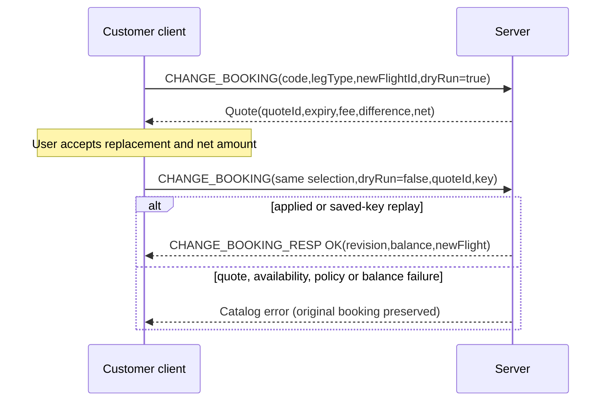

Coverage: AS-19/30/31; examples #35–38.

## UC11 — Print ticket (R8)

Actor / preconditions: USER owns TICKETED booking and asks to print/save its current itinerary.

1. Client requests PRINT_TICKET. Server validates ownership/state and renders current bounded lines with PNR/passenger/ticket/flight/time/class.
2. PRINT_TICKET_RESP returns text/plain, filename and lines. Client safely treats filename as a basename, renders, then opens local print/save.
3. E_NOT_FOUND/E_STATE_CONFLICT prevents printing an active confirmation for unowned/unpaid/cancelled records. A cancelled print dialog or local printer error changes no server state. After notification/change, discard cached text and fetch current data.

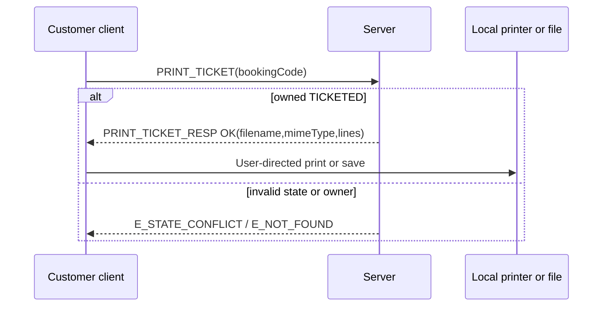

Coverage: AS-18; examples #33–34.

## UC12 — Receive / review flight notifications (R9)

Actor / preconditions: A committed admin update affects a customer's ticketed booking; notification is durably saved.

1. Server queues NOTIFY on authenticated customer sockets after commit. Client deduplicates notificationId, shows banner and refreshes current booking/version; it sends no automatic push acknowledgment.
2. On login/offline recovery, client pages GET_NOTIFICATIONS and displays the same full objects with read flags.
3. Opening/marking a notification sends ACK_NOTIFICATION. Server validates all owned IDs before marking any; already-read IDs are safe.
4. E_NOT_FOUND on any foreign/missing ID marks nothing. Push failure leaves the notification unread/recoverable. Events never replace newer state from a later booking/version.

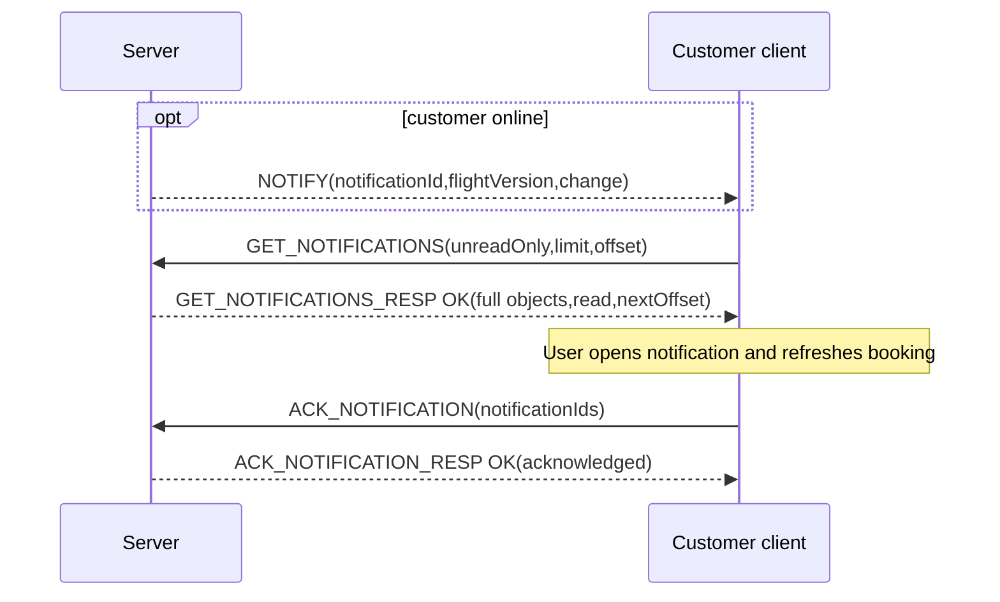

Coverage: AS-21/22/32; examples #45–49 (these show online pull, not an executed offline test).

## UC13 — Delay / reschedule flight (R9)

Actor / preconditions: ADMIN is authenticated; target flight is active and has not departed.

1. Admin lists flights and displays current version, times and reason input. Send ADMIN_UPDATE_FLIGHT with expectedVersion, stable key, action/reason and exactly that action's fields.
2. Server replays or checks role/version/future times; transaction updates flight/version, confirmed legs/revisions/audit/notifications and cancels whole pending holds on that flight.
3. Commit before admin reply and customer pushes. Admin displays saved counts; customers refresh bookings. E_VERSION_CONFLICT refreshes before a distinct accepted update; E_STATE_CONFLICT blocks departed/cancelled flights; E_VALIDATION fixes parameters.
4. Same-key retry cannot add DELAY twice. Failed/offline pushes recover through stored inbox.

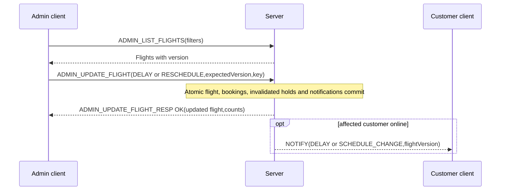

Coverage: AS-21/25/28/29/32; examples #43–45 and supporting RESCHEDULE exchange.

## UC14 — Cancel flight (R9)

Actor / preconditions: ADMIN confirms cancellation of an active future flight using its current version.

1. Send ADMIN_UPDATE_FLIGHT action=CANCEL with reason/expectedVersion/stable key.
2. In one transaction server marks flight CANCELLED, cancels each affected live booking as a whole, releases seats on **every** leg, refunds ticketed net paid including change fees once, invalidates tickets, and records audit/notifications/result.
3. Reply reports changed bookings and persisted notifications; push follows commit. Pending holds cancel with zero refund; already terminal bookings are excluded.
4. E_FORBIDDEN prevents customers executing this; E_VERSION_CONFLICT/E_STATE_CONFLICT refreshes admin state. Internal failure rolls back the entire affected set. Payment races yield rejection or a paid booking followed by one refund; never an unpaid debit or active ticket on a cancelled flight.

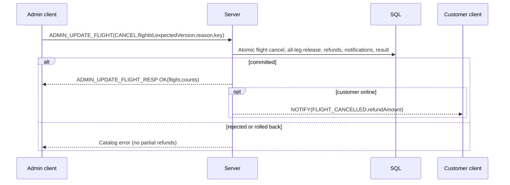

Coverage: AS-24/29; supporting cancellation/refund transcript.
